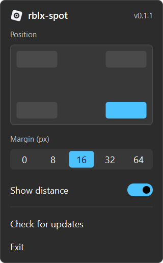

  

<h1 align="center">rblx-spot</h1>

See which Roblox server you're on and where it is.

## ✨ Features

- 🌍 Shows the server's IP address, region and distance from you in a corner of the game
- 👻 Click-through overlay that only appears while Roblox is the focused window
- ⚙️ Pick the corner, margin and whether to show distance from the tray
- 🪶 Small and quiet, lives in the system tray

## 🚀 Usage

1. Download `rblx-spot-<version>.exe` from [Releases](../../releases/latest) and run it (Windows 10 or 11).
2. Join a Roblox game. The overlay appears in the bottom-right corner by default.
3. Click the tray icon to change settings or **Exit**.

Region lookups use [ipinfo.io](https://ipinfo.io).

## ⚙️ Settings

Click the tray icon to open the settings. Changes apply right away.

## 📄 License

Licensed under the [Apache License 2.0](LICENSE). Not affiliated with or endorsed by Roblox Corporation.
